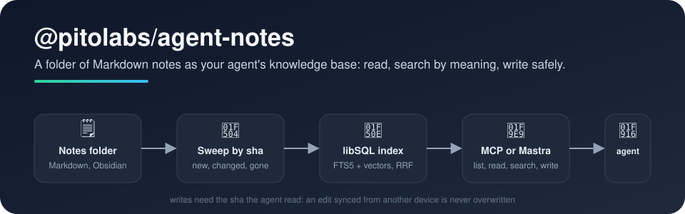

<p align="center">
  
</p>

<p align="center">
  <a href="https://www.npmjs.com/package/@pitolabs/agent-notes"></a>
  <a href="https://github.com/pitolabs/agent-notes/actions/workflows/ci.yml"></a>
  <a href="LICENSE"></a>
</p>

# 👋 Welcome to agent-notes

Give your AI agent **a folder of Markdown notes as its knowledge base** — an Obsidian vault, or one folder of it. The
agent lists, reads and searches the notes by keyword and by meaning (*"what did we already check when the internet
kept dropping?"* finds the network note even if it never says "internet"), and writes notes back without clobbering an
edit that arrived from your phone in the meantime.

Use it as an **MCP server** for any client (Claude Code, Cursor, OpenCode, your own agent), as **Mastra tools** in
your process, or as a plain TypeScript SDK.

## ✨ What you get

- 🗒️ **Four tools**: `list_notes`, `read_note`, `search_notes`, `write_note` (left out with `--read-only`).
- 🔎 **Hybrid search in a single libSQL file**: FTS5 keywords (accents folded) + chunk vectors, fused by reciprocal
  rank, filtered by folder or tag; plain word search over the files when no index is configured.
- 🛡️ **Writes that never overwrite someone else's edit**: changing a note needs the `sha` from `read_note`; if the
  file changed since (Obsidian Sync, LiveSync, Syncthing, a git pull), the write is refused and the agent reads again.
- 🔄 **An index that follows the folder by itself**: a sweep by sha every 10 minutes and after each write — new or
  changed notes are re-indexed, deleted ones dropped, unchanged ones skipped.
- 🏷️ **Obsidian-aware**: YAML frontmatter `title`, `tags`, `aliases`, `modified`; hidden files and symlinks never
  read; paths outside the folder refused.
- 🔌 **Pick your embedder**: Amazon Bedrock, OpenRouter, or any OpenAI-compatible `/embeddings` (OpenAI, Ollama, LM
  Studio, vLLM).
- 🌐 **stdio or HTTP**: `agent-notes mcp --http` serves Streamable HTTP with an optional Bearer token and a `/health`
  endpoint; a `Dockerfile` runs it as a container.

## 🪶 Light, cheap, yours

- 🪶 **Lightweight**: five runtime dependencies (`@libsql/client`, `@modelcontextprotocol/sdk`, `@pitolabs/agent-docs`,
  `yaml`, `zod`); no model to download, no vector database to run. The index is one SQLite file; the image fits in a
  256 MB container.
- 💸 **Low cost**: one embedding pass per changed note; a search is one keyword query and one query embedding.
- 🔐 **Yours**: the notes stay in your folder, the source of truth. Only note text goes to the embeddings provider you
  choose (a local Ollama keeps it on your machine); errors and logs never carry it. Delete the database file and the
  index rebuilds itself from the folder.

## 🚀 Quick start

As an MCP server, for any client (here Claude Code; the [guide](docs/guide.md) has Cursor, OpenCode and Docker):

```bash
claude mcp add notes -e EMBEDDINGS_PROVIDER=openai-compatible -e EMBEDDINGS_BASE_URL=http://localhost:11434/v1 \
  -e EMBEDDINGS_MODEL=bge-m3 -- npx -y @pitolabs/agent-notes mcp --dir ~/notes --db file:$HOME/.cache/agent-notes/notes.db
```

As Mastra tools, in your process:

```bash
bun add @pitolabs/agent-notes      # or: npm install @pitolabs/agent-notes
```

```ts
import { Agent } from "@mastra/core/agent";
import { createEmbedder, embeddingsConfig, NotesFolder, notesTools, openAgentNotes } from "@pitolabs/agent-notes/mastra";

const folder = await NotesFolder.open({ dir: "/srv/notes/company" }, "[clerk]");
const cfg = embeddingsConfig(process.env); // EMBEDDINGS_PROVIDER, EMBEDDINGS_*, OPENROUTER_API_KEY
if ("off" in cfg) throw new Error(cfg.off);
const embedder = createEmbedder(cfg);
const opened = await openAgentNotes({ url: "file:./notes-clerk.db", folder, embedder, log: "[clerk]" });
if ("off" in opened) throw new Error(opened.off);
opened.indexer.start(); // sweeps the folder now and every 10 min

export const clerk = new Agent({
	id: "clerk",
	name: "Clerk",
	model: "openai/gpt-4o-mini",
	instructions: "You answer from the company's notes. Read a note before you state a fact from it.",
	tools: notesTools({ folder, ...opened, embedder, kbName: "da empresa" }),
});
```

`kbName` is the base's name in the tool descriptions. What the host still decides — which folder, which model, whether
the agent may write (`readOnly`) — is in the [guide](docs/guide.md).

## 📚 Learn more

| | |
|---|---|
| 📖 [Guide](docs/guide.md) | MCP clients, HTTP and Docker, Mastra, the SDK; one folder per agent |
| 🔎 [Reference](docs/reference.md) | CLI flags, environment, `/health`, the tools' inputs and outputs, the sweep, what is stored |
| 🗺️ [Design notes](docs/design.md) | Why a sweep and not events, why not QMD as an SDK, why one index per folder |
| 🧑‍💻 [Contributing](CONTRIBUTING.md) | Hooks, formatting, tests, the privacy scan |

## 🧭 When to use something else

- [Basic Memory](https://github.com/basicmachines-co/basic-memory): a complete MCP server with a knowledge graph over
  Markdown (Python, AGPL).
- [foam-notes-mcp](https://github.com/fbdo/foam-notes-mcp): a TypeScript MCP server with a wikilink graph and local
  embeddings.
- [QMD](https://github.com/tobi/qmd): a local search engine for Markdown with a reranker; read-only.

This package is for one folder per agent, writes that never overwrite edits made elsewhere, and the choice between in
process, MCP over stdio, or a container.

## 🌍 Languages

Tool descriptions and messages are in **Brazilian Portuguese** in this release (the model reads them and answers in
that language). An English set is on the list.

## 💛 Made by Pito Labs

Extracted from the agents we run for our own businesses, whose knowledge lives in an Obsidian vault. MIT licensed —
use it, fork it, tell us what you built.
